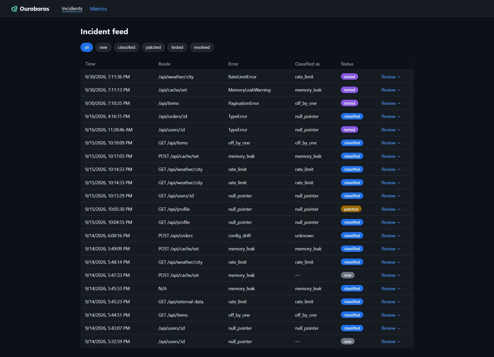
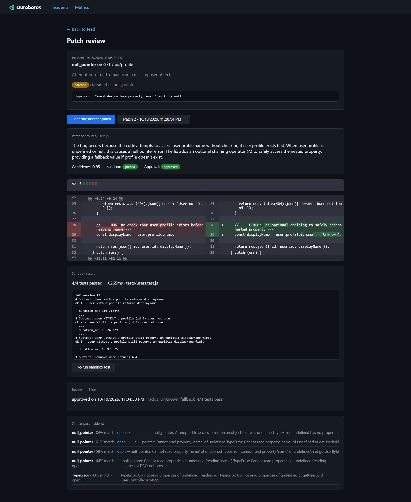
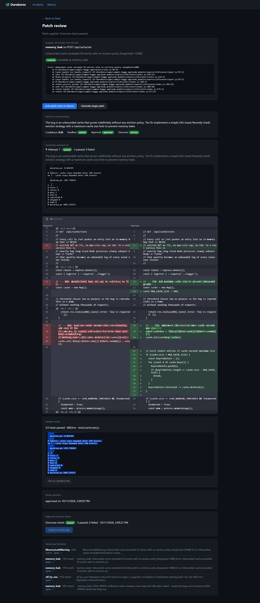

# Ouroboros: Self-Healing CI/CD Pipeline

> A deployment pipeline that consumes its own failure history to heal itself.

Ouroboros ingests production errors, classifies them, finds similar past incidents, asks an LLM for a candidate patch, tests that patch in an isolated Docker sandbox, and keeps a human approval gate before anything ships. When a patch fails the sandbox, the failing test output is fed back to the LLM for another try. After an approved patch is applied, the tests run again, and the change is rolled back automatically if they fail.




## How it works

1. **Ingest**: errors from the sample app arrive at `POST /api/incidents/ingest`.
2. **Classify**: rules first, LLM fallback. Types include `null_pointer`, `memory_leak`, `rate_limit`, `off_by_one` and `config_drift`.
3. **Remember**: each incident is embedded (MiniLM, 384 dims) and stored in Supabase pgvector. Similar past incidents are retrieved by cosine similarity.
4. **Patch**: Claude (Anthropic API) generates a fix, given the incident, the source file and similar past incidents.
5. **Test**: the patch runs against the test suite in a Docker container with no network, a read-only filesystem, and memory/CPU/time limits.
6. **Retry**: if the sandbox fails the patch, the failing test output goes back to the LLM and a new patch is generated, up to 3 attempts. Every attempt is stored on the patch.
7. **Review**: a human approves or rejects in the dashboard. Approve is locked unless the sandbox passed.
8. **Apply**: only approved, sandbox-passed patches can be applied to the sample app. The original file is backed up first.
9. **Verify and roll back**: the tests run again against the file on disk. The patch is marked `success`, or the original file is restored and the patch is marked `reverted`.



## Tech stack

| Layer | Tech |
|---|---|
| Backend | Node.js, Express, MongoDB (Mongoose) |
| Dashboard | React, Vite, React Router |
| Vector search | Supabase pgvector, `@xenova/transformers` |
| LLM | Anthropic API |
| Sandbox | Docker |

## Repo layout

```
apps/
  backend/            Express API (incidents, patches, metrics)
  dashboard/          React dashboard (feed, patch review, metrics)
  sample-buggy-app/   the "production" app seeded with 4 bug patterns
infra/                Dockerfile for the sandbox, DB seeds and migrations
docs/                 architecture, screenshots and demo script
```

## Run it locally

Prerequisites: Node 20+, Docker Desktop, a MongoDB URI, a Supabase project, an Anthropic API key.

```powershell
# backend
cd apps\backend
copy .env.example .env    # then fill in your keys
npm install
npm run dev               # http://localhost:5000

# dashboard (second terminal)
cd apps\dashboard
npm install
npm run dev               # http://localhost:5173
```

## API

| Route | Purpose |
|---|---|
| `POST /api/incidents/ingest` | ingest and classify an error |
| `GET /api/incidents` | list incidents |
| `GET /api/incidents/:id/similar` | similar past incidents |
| `POST /api/patches/:id/generate` | generate a single patch (incident id) |
| `POST /api/patches/:id/auto` | generate and test with up to 3 retries (incident id) |
| `GET /api/patches/:id` | patches for an incident |
| `POST /api/patches/:id/test` | run the sandbox test (patch id) |
| `POST /api/patches/:id/approve` and `/reject` | human review (patch id) |
| `POST /api/patches/:id/apply` | apply, verify and roll back on failure (patch id) |
| `GET /api/patches/:id/original` | original file for the diff (patch id) |
| `GET /api/metrics` | dashboard metrics |

## Safety

Patches are never applied without a human decision. Every patch must pass the sandbox tests and be approved before it can be applied, and applying runs the tests a second time against the real file, restoring the original if they fail. A patch that was reverted cannot be re-applied.

The sandbox catches weak patches: for the profile bug, two of three generated patches dropped a response field and failed the tests. With auto-retry, the failure output is fed back so the next attempt can fix it.

## Status

- [x] Phases 1-3: sample app, ingestion, classification, vector search
- [x] Phase 4: LLM patch generation
- [x] Phase 5: Docker sandbox test runner
- [x] Phase 6: dashboard, approve/reject, metrics
- [x] Phase 7: auto-retry with failure feedback, apply approved patches, outcome check with rollback
- [ ] Phase 8 (optional): Slack bot, postmortem generator